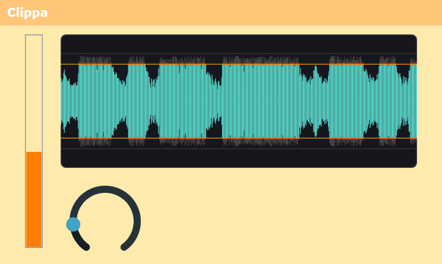

# Clippa

Simple clipper VST made on JUCE.

# Functionality

* Threshold:
  
  Set a threshold with the bar on the left. Value range is from -20 to +10 db
* Output gain:
  
  Outputs up to +20 db
* Monitoring:
  
  See your signal, cut parts and threshold lines

---
**Version 1.0**

---
This is a template repo!

That means you can click "[Use this template](https://github.com/sudara/pamplejuce/generate)" here or at the top of the page to get your own copy (not fork) of the repo. Then you can make it private or keep it public, up to you.

Then check out the [documentation](https://melatonin.dev/manuals/pamplejuce/setting-your-project-up/) so you know what to tweak.
